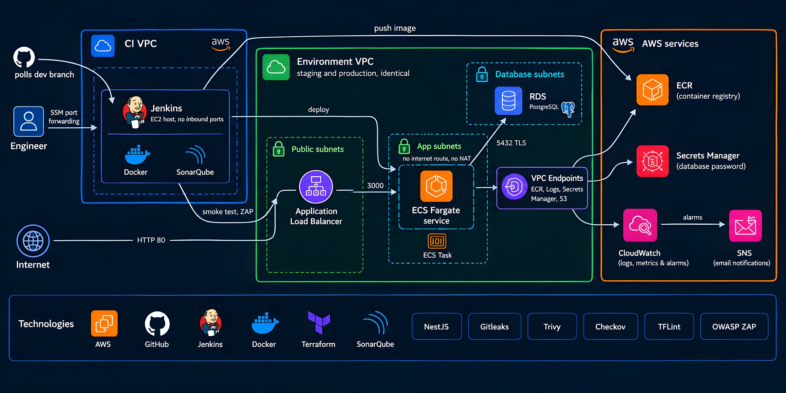
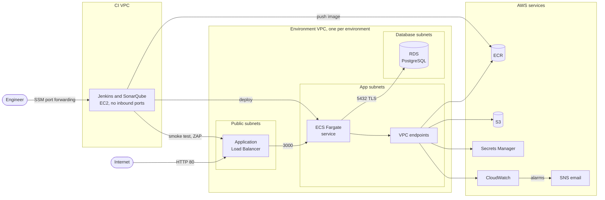
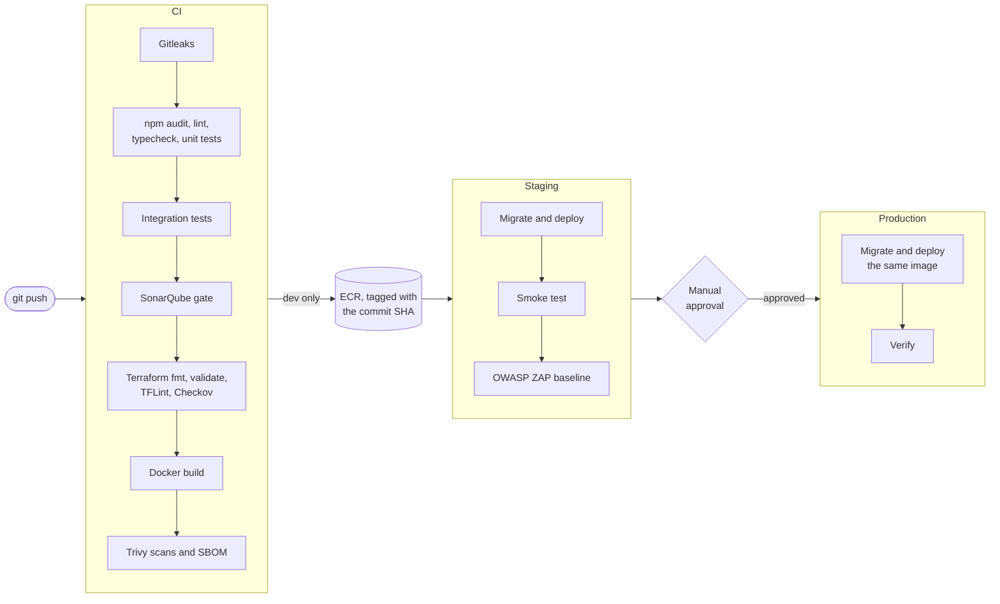

# Jenkins Secure Delivery Pipeline

A CI/CD pipeline that takes a small NestJS API from a commit to AWS, with security checks along the way. Jenkins tests and scans every commit, deploys `dev` to a staging environment on ECS Fargate, runs OWASP ZAP against it, and waits for a person to approve before the same image goes to production. The infrastructure is Terraform, and every check below was triggered on purpose at least once.



## Stack

- API: NestJS on Node.js 24 with PostgreSQL 17, tested with Vitest, Supertest and Testcontainers
- CI/CD: Jenkins, with the pipeline and Jenkins itself configured in code, and every tool running in a container pinned by digest
- Checks: Gitleaks, npm audit, SonarQube, TFLint, Checkov, Trivy (plus a CycloneDX SBOM) and OWASP ZAP
- Infrastructure: Terraform with remote state in S3, on AWS VPC, ALB, ECS Fargate, RDS, ECR, Secrets Manager, CloudWatch and SNS

## Architecture

Staging and production are identical VPCs across two availability zones. The load balancer is the only public part. The ECS tasks and the database sit in private subnets with no route to the internet, and the tasks reach ECR, S3 (where ECR keeps image layers), CloudWatch Logs and Secrets Manager through VPC endpoints instead of a NAT gateway. RDS generates and rotates the database password, and ECS injects it when a task starts, so it never appears in code or in Terraform state.

Jenkins and SonarQube run on an EC2 host with no inbound ports. They're reached through SSM port forwarding, and Jenkins calls AWS with the instance role instead of access keys. [docs/architecture.md](docs/architecture.md) has the details.

<details>
<summary>The same architecture as a Mermaid diagram</summary>



</details>

## How a change ships



1. Every branch gets secret scanning, the dependency audit, lint, type checks, unit and integration tests, the Terraform checks and an image build scanned by Trivy. On `dev`, SonarQube's quality gate runs too.
2. The `dev` image is pushed to ECR, tagged with the commit SHA. Tags can't be overwritten.
3. Jenkins registers a task definition revision with the new image, runs the database migrations as a one-off task and rolls the service.
4. A smoke test and a ZAP baseline scan run against staging.
5. The build waits for approval. If an admin approves within 30 minutes, production gets the same image and is verified; otherwise nothing changes.

Any failing check stops the build, and it takes about 10 minutes to reach the approval ([stage timings](docs/evidence/pipeline-run.md)). If new tasks fail their health checks, the ECS circuit breaker rolls the service back, and CloudWatch alarms send an email when users get 5xx errors or no task is healthy.

## Failures tested on purpose

| What was broken | What caught it |
|---|---|
| A token committed to a repository | [Gitleaks](docs/evidence/gitleaks-secret-scan.md) |
| `Math.random()` used where the value has to be unpredictable | [SonarQube quality gate](docs/evidence/sonarqube-quality-gate.md) |
| The database port opened to the internet | [Checkov, with a custom policy](docs/evidence/checkov-blocks-open-database.md) |
| HIGH CVEs in the base image | [Trivy](docs/evidence/trivy-base-image-update.md) |
| Missing security headers | [ZAP on staging](docs/evidence/zap-blocks-promotion.md) |
| A release that never becomes healthy | [ECS circuit breaker rollback](docs/evidence/ecs-rollback.md) |
| A release that passes health checks but returns 500s | [CloudWatch alarm email](docs/evidence/cloudwatch-alarms.md) |

## Security

Secrets stay out of Git: Gitleaks runs on every commit, nothing uses static AWS keys (Jenkins has an instance role, people use SSO, tasks use IAM roles), and the database password only exists in Secrets Manager. Base images and CI tools are pinned by digest, and the Trivy, jq, curl and distroless images were checked with Cosign before pinning. The container is distroless, runs as a non-root user with a read-only filesystem, and talks to the database over verified TLS. IAM is least privilege, and the Jenkins role was trimmed using IAM Access Analyzer and last-accessed data.

The [threat model](docs/threat-model.md) goes through each threat, the control that covers it, and the risks accepted on purpose.

## Design choices

- ECS Fargate instead of EKS, because one stateless service doesn't justify running a Kubernetes cluster.
- VPC endpoints instead of a NAT gateway. The tasks only need four AWS services, so they get those and no general internet access.
- Jenkins only swaps the image in the task definition. Terraform owns everything else, so the pipeline has no permission to change infrastructure.
- Production gets the image digest that passed staging. Nothing is rebuilt after testing.
- Each scanner has one job. SonarQube reads this repository's code, Trivy looks for known CVEs in packages and image layers, TFLint catches Terraform mistakes, and Checkov enforces security policy.
- Both environments are created and destroyed around each working session. An environment costs about 0.15 USD/h and the Jenkins host about 0.08 USD/h, so a four-hour session costs about 1.50 USD.

## What would change in production

- HTTPS with ACM and a WAF on the load balancer
- Separate AWS accounts for staging and production
- Multi-AZ RDS with deletion protection and longer backups
- Automatic rollback when the production verification fails
- SSO for Jenkins, and webhooks instead of polling
- Renovate to keep the pinned versions current

## Running it

Locally:

```bash
cp .env.example .env
docker compose up --build
curl http://127.0.0.1:3000/health
```

On AWS, apply the Terraform stacks in order (`bootstrap`, `shared`, `ci`, then each environment), push to `dev`, and approve the production stage in Jenkins. The [deployment guide](docs/deployment.md) has the exact commands, the teardown steps and the costs.

## Repository

```text
app/          NestJS API, tests, Dockerfile and migrations
infra/        Terraform: bootstrap, shared, ci, the environment module, staging and production
jenkins/      Jenkins and SonarQube images and configuration
scripts/      CI host bootstrap and the SSM tunnel
checkov/      Custom Checkov policy
zap/          ZAP baseline rules
docs/         Architecture, threat model, deployment guide and evidence
Jenkinsfile   The pipeline
```

## Status

A practice project, last updated on October 7, 2026. It isn't maintained, so the pinned versions and image digests will fall behind and new vulnerabilities will show up over time; update them before reusing any of it. The AWS environments only existed during working sessions, so there is no live endpoint.

AI assistants sped up the writing, the same way they do in my day-to-day work. The decisions and trade-offs were mine, and I can explain what any part of this does and why.
