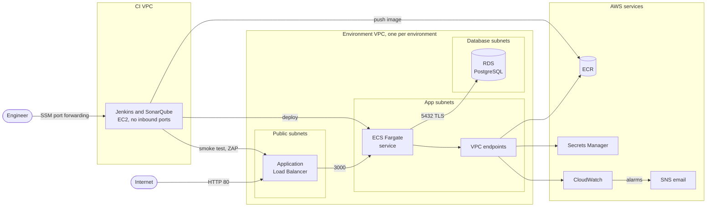

# Architecture

Two identical AWS environments, staging and production, run the API. A separate CI host runs Jenkins and SonarQube, and a few long-lived resources (state bucket, image registry, alarm topic) are shared. Everything is defined in Terraform.

Staging uses 10.0.0.0/16, production 10.2.0.0/16 and the CI VPC 10.1.0.0/16. The S3 state bucket, the ECR repository and the SNS topic are shared by both environments.

## Terraform layout

| Stack | Contains | Lifecycle |
|---|---|---|
| `infra/bootstrap` | S3 state bucket and its KMS key | Created once, protected with `prevent_destroy` |
| `infra/shared` | ECR repository and registry scanning, SNS alarm topic | Long lived |
| `infra/ci` | CI VPC, Jenkins host, its IAM role, flow logs | Long lived, host stopped between sessions |
| `infra/environments/staging`, `production` | Backend, provider and one call to the environment module | Created and destroyed every working session |
| `infra/modules/environment` | The 56 resources of one environment: network, endpoints, security groups, load balancer, ECS, RDS, logs and alarms | Inputs: `name`, `vpc_cidr` (a /16) and `image_tag` |

Each stack keeps its state under its own key in the S3 backend, encrypted with a dedicated KMS key, versioned, and locked with native S3 lock files, so no DynamoDB table is needed. The environments started as two flat copies and moved into the module once both worked; comparing the plans before and after showed the same 56 resources with the same values.

Provider default tags put `Project`, `ManagedBy` and `Environment` or `Stack` on every resource, and TFLint fails the build if a stack's provider is missing them.

## Network

Each environment has a /16 VPC across two availability zones with three pairs of /24 subnets:

| Subnets | Contents | Route to the internet |
|---|---|---|
| Public (blocks 0 and 1) | Load balancer | Internet gateway |
| App (blocks 10 and 11) | ECS tasks, interface endpoints | None |
| Database (blocks 20 and 21) | RDS | None |

There is no NAT gateway. The tasks reach the AWS services they need through VPC endpoints: interface endpoints for the ECR API, ECR Docker registry, CloudWatch Logs and Secrets Manager, and a free gateway endpoint for S3, where ECR keeps image layers.

Security groups allow only these paths, and the default security group has no rules:

| From | To | Port |
|---|---|---|
| Internet | Load balancer | 80 |
| Load balancer | Tasks | 3000 |
| Tasks | RDS | 5432 |
| Tasks | Interface endpoints | 443 |
| Tasks | S3 prefix list | 443 |

RDS and the endpoints have no egress rules because they only answer. VPC flow logs record every accepted and rejected connection, and a saved Logs Insights query ranks the rejected ones.

## Runtime

**ECS Fargate.** The `api` service runs one task (0.25 vCPU, 512 MB) in the app subnets, without a public IP. The container runs as a non-root user with a read-only root filesystem and every Linux capability dropped. Deployments are rolling: a new task has to pass the load balancer health check before the old one is drained. The deployment circuit breaker marks a deployment as failed after three consecutive failed tasks and rolls back to the last completed one.

**Load balancer.** A public ALB with an HTTP listener on port 80 and a target group on port 3000. The health check calls `GET /health` every 15 seconds; a target is healthy after 2 successes and unhealthy after 3 failures. Requests with invalid header fields are dropped.

**Database.** RDS PostgreSQL 17 on db.t3.micro with 20 GB of encrypted gp3 storage in the database subnets, not publicly accessible. The parameter group forces TLS (`rds.force_ssl = 1`), and the API connects with `PGSSLMODE=verify-full` against the RDS CA bundle copied into the image. RDS generates the master password, keeps it in Secrets Manager and rotates it every 7 days. ECS injects the username and password into the container when it starts, so they never appear in the task definition or in Terraform state.

**Migrations.** SQL migrations (node-pg-migrate) run as a one-off ECS task with the new task definition revision, before the service is updated. If they fail, the service keeps running the previous version.

## Identities

| Role | Used by | Allowed to |
|---|---|---|
| Task execution role | ECS, to start a task | Pull `jsp-api`, write the API log group, read the database secret |
| Task role | The API code while it runs | Nothing, since the API calls no AWS API |
| Jenkins instance role | The pipeline | Push to `jsp-api`. Per environment: register revisions of the API task family, run the migration task, move the `api` service to a revision of its own family and pass the two task roles to ECS. The SSM agent calls for this instance |

People sign in through IAM Identity Center. The account has no IAM users and no access keys.

## CI host

Jenkins and SonarQube run with Docker Compose on one EC2 instance (t3a.large, Amazon Linux 2023) in its own VPC.

- **No inbound access.** The security group has no ingress rule. Egress is limited to 443 (GitHub, registries, AWS APIs), 80 (the environment load balancers, for the smoke test and ZAP) and 22 (git over SSH). The public IP is only used for egress.
- **Access through SSM.** `scripts/jenkins-tunnel.sh` forwards Jenkins (8080) or SonarQube (9000) to the workstation with Session Manager. There is no SSH key pair.
- **Containers.** The Jenkins controller (no executors, configured as code, plugins pinned), an SSH agent with two executors, an isolated `docker:dind` daemon reached over mutual TLS, and SonarQube with its own PostgreSQL on an internal network.
- **Credentials.** The instance role comes from IMDSv2 with a hop limit of 2. The Jenkins containers can reach it, but containers that builds start inside Docker-in-Docker cannot. The pipeline only uses it from AWS CLI containers started with `--network host`.
- **Source.** A multibranch job polls GitHub every 5 minutes with a read-only deploy key, so GitHub never has to reach the host.
- **Lifecycle.** The host is stopped between working sessions and keeps its data on an encrypted 40 GB volume. A systemd unit starts and stops the Compose stack.

## Observability

**Logs.** The API writes JSON lines to `/ecs/<env>-api`, one per request with method, path, status, duration and the load balancer trace ID. RDS exports its PostgreSQL log, and flow logs have their own group. Retention is 7 days. Saved queries list API errors and rejected connections.

**Alarms.** Each environment has two, and both notify the shared SNS topic `jsp-alarms`, which emails a subscribed address:

| Alarm | Fires when |
|---|---|
| `<env>-http-5xx` | 5 or more 5xx responses in a minute, counting the API's errors and the ones the load balancer returns when no task answers |
| `<env>-no-healthy-targets` | No task has passed the health check for two minutes |

An alarm on the count of unhealthy targets was tried first and dropped: ECS stops an unhealthy task within a second, so the per-minute metric never sees it. When no target is registered at all, the load balancer stops publishing the healthy count, and CloudWatch waits about ten minutes before it treats the gap as breaching. With traffic, the 5xx alarm catches that case in about three minutes.

**Image to commit.** Every image is tagged with its full commit SHA and labeled with `org.opencontainers.image.revision`, so the task definition running in an environment names the commit it was built from.
