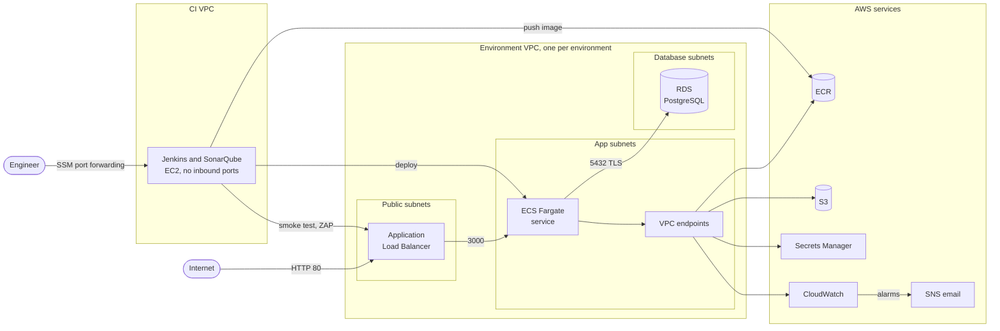

# Architecture

Here's how the pieces fit together. The API runs in two identical AWS environments, staging and production. Jenkins and SonarQube live on a separate CI host. A few long-lived resources are shared by everything: the bucket that holds the Terraform state, the image registry and the topic that sends alarm emails. All of it is defined in Terraform.

Staging uses 10.0.0.0/16, production 10.2.0.0/16 and the CI VPC 10.1.0.0/16. The S3 state bucket, the ECR repository and the SNS topic are shared by both environments.

## Terraform layout

The infrastructure is split into stacks. A stack is a folder with its own Terraform state, and I split them by how long things live: the state bucket is created once and never touched again, while the environments come and go every working session.

| Stack | What's in it | How long it lives |
|---|---|---|
| `infra/bootstrap` | S3 state bucket and its KMS key | Created once, protected with `prevent_destroy` |
| `infra/shared` | ECR repository and registry scanning, SNS alarm topic | Long lived |
| `infra/ci` | CI VPC, Jenkins host, its IAM role, flow logs | Long lived, the host is stopped between sessions |
| `infra/environments/staging`, `production` | Backend, provider and one call to the environment module | Created and destroyed every working session |
| `infra/modules/environment` | The 56 resources of one environment: network, endpoints, security groups, load balancer, ECS, RDS, logs and alarms | Takes `name`, `vpc_cidr` (a /16) and `image_tag` |

Every stack keeps its state under its own key in the same S3 bucket. The bucket is encrypted with a dedicated KMS key and versioned, so an older state can always be recovered. While Terraform writes, it locks the state with a lock file in S3, so two applies can't step on each other. Current Terraform does this natively, so there's no DynamoDB table.

The environments started as two flat copies and became one module once both worked. Comparing the plans before and after showed the same 56 resources with the same values ([details](evidence/terraform-module-refactor.md)).

Default tags on the provider put `Project`, `ManagedBy` and `Environment` or `Stack` on every resource, so you can always tell where a resource came from. TFLint fails the build if a stack's provider is missing them.

## Network

Each environment gets its own VPC, a /16 across two availability zones, with three pairs of /24 subnets:

| Subnets | What runs there | Route to the internet |
|---|---|---|
| Public (blocks 0 and 1) | Load balancer | Internet gateway |
| App (blocks 10 and 11) | ECS tasks, interface endpoints | None |
| Database (blocks 20 and 21) | RDS | None |

The idea is simple: only the load balancer can be reached from the internet. The tasks and the database sit in subnets with no route out at all.

There's no NAT gateway either. A NAT gateway would give the tasks general internet access, which they don't need. Instead they reach the few AWS services they use through VPC endpoints, which work like private phone lines that can only call one service each: interface endpoints for the ECR API, the ECR Docker registry, CloudWatch Logs and Secrets Manager, plus a free gateway endpoint for S3, where ECR keeps image layers.

Security groups are the firewall around each piece, and they only allow these paths (the VPC's default security group has no rules):

| From | To | Port |
|---|---|---|
| Internet | Load balancer | 80 |
| Load balancer | Tasks | 3000 |
| Tasks | RDS | 5432 |
| Tasks | Interface endpoints | 443 |
| Tasks | S3 prefix list | 443 |

RDS and the endpoints have no egress rules because they only answer connections, they never start one. VPC flow logs record every accepted and rejected connection, and a saved Logs Insights query ranks the rejected ones. That's the first place to look when something can't connect.

## Runtime

The API runs as an ECS Fargate service called `api`: one task with 0.25 vCPU and 512 MB in the app subnets, with no public IP. Fargate means AWS runs the servers and I only describe the container. The container runs as a non-root user, with a read-only root filesystem and every Linux capability dropped, so even with code execution inside it there's very little an attacker could change.

Deployments are rolling. ECS starts the new task next to the old one, and the old one is only drained once the new one passes the load balancer health check. If three new tasks in a row fail, the deployment circuit breaker marks the deployment as failed and goes back to the last one that completed ([demo](evidence/ecs-rollback.md)).

The load balancer is a public ALB with an HTTP listener on port 80 and a target group on port 3000. The health check calls `GET /health` every 15 seconds; a task counts as healthy after 2 successes and unhealthy after 3 failures. Requests with invalid header fields are dropped.

The database is RDS PostgreSQL 17 on a db.t3.micro, with 20 GB of encrypted gp3 storage in the database subnets, and it isn't publicly accessible. The server refuses connections without TLS (`rds.force_ssl = 1`), and the API connects with `PGSSLMODE=verify-full`, checking the server's certificate against the RDS CA bundle copied into the image. The verification is the important part: encryption alone wouldn't stop something from pretending to be the database.

Nobody handles the database password by hand. RDS generates it, keeps it in Secrets Manager and rotates it every 7 days. ECS reads it and injects the username and password into the container when it starts, so they never show up in the task definition or in Terraform state.

Migrations are plain SQL files run by node-pg-migrate. Each deploy runs them as a one-off ECS task with the new task definition revision, before the service is updated. If they fail, the service keeps running the previous version.

## Identities

There are three roles, and they're easy to mix up. The short version: the execution role is what ECS uses to start the container, the task role is what the code inside it can do, and the Jenkins role is what the pipeline can do.

| Role | Used by | Allowed to |
|---|---|---|
| Task execution role | ECS, to start a task | Pull `jsp-api`, write the API log group, read the database secret |
| Task role | The API code while it runs | Nothing, since the API calls no AWS API |
| Jenkins instance role | The pipeline | Push to `jsp-api`. Per environment: register revisions of the API task family, run the migration task, move the `api` service to a revision of its own family and pass the two task roles to ECS. The SSM agent calls for this instance |

People sign in through IAM Identity Center (SSO). The account has no IAM users and no access keys at all.

## CI host

Jenkins and SonarQube run with Docker Compose on one EC2 instance (t3a.large, Amazon Linux 2023) in its own VPC. The main idea is that nothing on the internet can start a connection to it.

- The security group has no ingress rule at all. Outbound traffic is limited to 443 (GitHub, registries, AWS APIs), 80 (the environment load balancers, for the smoke test and ZAP) and 22 (git over SSH), and the public IP is only used for that outbound traffic.
- To open Jenkins (8080) or SonarQube (9000), `scripts/jenkins-tunnel.sh` forwards the port to my machine through Session Manager. There's no SSH key pair to lose.
- The containers are the Jenkins controller (no executors, configured as code, plugins pinned), an SSH agent with two executors, an isolated `docker:dind` daemon reached over mutual TLS, and SonarQube with its own PostgreSQL on an internal network.
- The instance role comes from the instance metadata service (IMDSv2) with a hop limit of 2. The Jenkins containers can reach it, but containers that builds start inside Docker-in-Docker are one hop too far. The pipeline only uses the role from AWS CLI containers started with `--network host`.
- A multibranch job polls GitHub every 5 minutes with a read-only deploy key, so GitHub never needs a way in.
- I stop the host between working sessions, and its data stays on an encrypted 40 GB volume. A systemd unit starts and stops the Compose stack together with the machine.

## Observability

The API writes one JSON line per request to `/ecs/<env>-api`, with the method, path, status, duration and the load balancer's trace ID. RDS exports its PostgreSQL log, and the flow logs have their own group. Everything is kept for 7 days. Saved queries list API errors and rejected connections.

Each environment has two alarms, and both notify the shared SNS topic `jsp-alarms`, which emails a subscribed address:

| Alarm | Fires when |
|---|---|
| `<env>-http-5xx` | 5 or more 5xx responses in a minute, counting the API's errors and the ones the load balancer returns when no task answers |
| `<env>-no-healthy-targets` | No task has passed the health check for two minutes |

I tried an alarm on the number of unhealthy targets first and dropped it: ECS stops an unhealthy task within a second, so the per-minute metric never sees it. When no target is registered at all, the load balancer stops publishing the healthy count, and CloudWatch waits about nine minutes before it treats the missing data as a problem. If there's traffic, the 5xx alarm catches that case in about three minutes. The [alarm demos](evidence/cloudwatch-alarms.md) show all three cases.

Finally, every image is tagged with its full commit SHA and labeled with `org.opencontainers.image.revision`, so the task definition running in an environment tells you exactly which commit it was built from.
