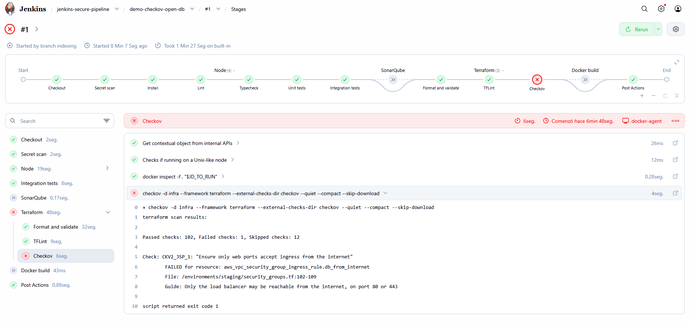

# Checkov blocks an open database port

One of the worst things that could happen to this project is the database being reachable from the internet. So I tried it: on a throwaway branch, `demo-checkov-open-db`, I added a security group rule that opened PostgreSQL (port 5432) to `0.0.0.0/0`, which means any IP address in the world.

Checkov's built-in checks look for `0.0.0.0/0` on ports like 22 and 80, but they don't cover 5432. That's why the repository has a custom policy, `CKV2_JSP_1` in `checkov/internet_ingress.yaml`, with a simple rule: if something is open to the internet, it has to be exactly port 80 or 443, the web ports the load balancer is meant to expose. Anything else fails.

The branch build failed at `Checkov` and skipped `Docker build`, so nothing got packaged. The next commit on the branch removed the rule and the build passed. Then I deleted the branch.

