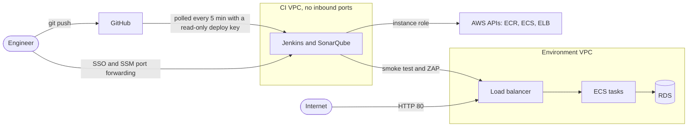

# Threat model

This model covers what the repository builds: the Jenkins pipeline, the CI host and the two AWS environments. It lists the assets, the points where trust changes hands, the threats that matter for this design, the control that answers each one and the risks that were accepted on purpose.

## Assets

| Asset | Where it lives | Why it matters |
|---|---|---|
| Source code and `Jenkinsfile` | Private GitHub repository | The `Jenkinsfile` decides what runs with the deploy permissions |
| Jenkins instance role | Instance metadata (IMDSv2) of the CI host | Pushes images and deploys staging and production |
| Container images | ECR repository `jsp-api`, immutable tags | The exact code that runs in each environment |
| Database and its password | RDS in private subnets, password kept by RDS in Secrets Manager | Application data |
| Terraform state | S3 bucket encrypted with a dedicated KMS key | Configuration and resource IDs of every stack |
| CI secrets | Root-only files on the CI host: deploy key, Jenkins and SonarQube admin passwords, SonarQube token | Control of the pipeline |
| AWS account access | IAM Identity Center (SSO) | Control of everything above |

## Trust boundaries

1. **Internet to load balancer.** The only public entry point: port 80 on each environment's load balancer.
2. **GitHub to Jenkins.** Code from the repository becomes a pipeline that runs with AWS permissions.
3. **Jenkins to AWS.** The instance role is the pipeline's identity.
4. **Tasks to data.** Tasks reach RDS and four AWS services over private paths, and RDS accepts connections only from the tasks.
5. **People to AWS.** SSO sessions only. There are no IAM users or access keys.

## Attack surface

- Public: the HTTP listener of each environment's load balancer. ECS tasks and RDS have no public address, and the CI host's security group has no inbound rule at all.
- Administrative: the AWS console and CLI through SSO, and the Jenkins and SonarQube interfaces through SSM port forwarding.
- Supply chain: npm packages, base images, CI tool images, Jenkins plugins and the Terraform provider, each pinned by version, digest or lock file.

## Threats and controls

| Threat | Controls in this repository | Residual risk |
|---|---|---|
| A secret is committed | Gitleaks scans each commit and fails the build. CI secrets are generated on the host and git-ignored. RDS creates the database password, so it never reaches Terraform state | A leaked secret still needs rotation and a history rewrite |
| Jenkins credentials are stolen | No inbound ports and SSM instead of SSH. IMDSv2 with a hop limit of 2 keeps the role away from containers inside Docker-in-Docker. The role is limited to one ECR repository and the two API services, can only move each service to a revision of its own task family, can pass the ECS roles only to ECS, and its SSM permissions cover only the agent on this instance | Every branch's `Jenkinsfile` runs on the same host and could use the role; the repository is private with a single committer |
| Vulnerable base image or OS package | Distroless nonroot runtime pinned by digest after a Cosign signature check. Trivy fails the build on fixable HIGH and CRITICAL findings, and an accepted finding needs an expiry date. ECR scans on push. Every build archives a CycloneDX SBOM | Unfixed CVEs are reported, not blocked. Trivy does not see the Node.js runtime inside distroless, so the base image is bumped on Node security releases |
| Malicious or vulnerable dependency | `npm ci` from the lock file with install scripts disabled. `npm audit` fails on HIGH findings in production dependencies and verifies registry signatures. Trivy scans the lock file. CI tool images are pinned by digest, and the Trivy, jq and curl images were verified with Cosign first | A malicious release with valid signatures and no advisory yet |
| Database exposed to the internet | Private subnets, `publicly_accessible = false`, port 5432 open only to the tasks' security group, TLS forced by the server and verified by the client against the RDS CA. A custom Checkov policy fails the build for any internet ingress other than ports 80 and 443 | A security group change made outside Terraform |
| Overly broad IAM permission | The execution role pulls one repository, writes one log group and reads one secret. The task role has no permissions. Jenkins' policies were reviewed with IAM Access Analyzer and last-accessed data | People use `AdministratorAccess` through SSO |
| Insecure Terraform change | TFLint and Checkov run on every commit before anything is deployed, and each Checkov skip sits inline with its reason. State is versioned, KMS-encrypted, TLS-only and locked during writes | Applies are run by a person from a workstation |
| Vulnerable running endpoint | SonarQube quality gate. Security headers set with helmet. A ZAP baseline scan of staging blocks promotion on FAIL rules | Passive scan only. No authentication, rate limiting or WAF |
| Bad release reaches users | Immutable commit tags. Staging first, with migrations, smoke test and ZAP. Manual approval for production, which receives the same image digest. Circuit breaker rollback. Alarms on 5xx responses and on the absence of healthy targets | A release that breaks after the production verification is rolled back by hand |
| Data leaves through a compromised task | No NAT gateway and no public IPs: tasks reach only ECR, CloudWatch Logs, Secrets Manager and S3, through VPC endpoints | The endpoints keep the default full-access policy |
| Sensitive data in logs | Request logs carry method, path, status, duration and trace ID. ECS injects the database credentials, which are never logged. Clients get generic error messages | Internal error logs contain stack traces |

## Accepted risks and out of scope

- The API has no authentication. It is the payload of the pipeline, not a product.
- The load balancers listen on HTTP only, because there is no domain for an ACM certificate.
- Staging and production share one AWS account.
- RDS runs in one availability zone with one day of backups and no deletion protection. Both environments are rebuilt every working session.
- The Jenkins admin password is a file on the CI host, and Jenkins has no SSO.
- Detection and response (CloudTrail analysis, GuardDuty, Security Hub) are outside this project.

The [README](../README.md#what-would-change-in-production) lists what would change for a real production deployment.
